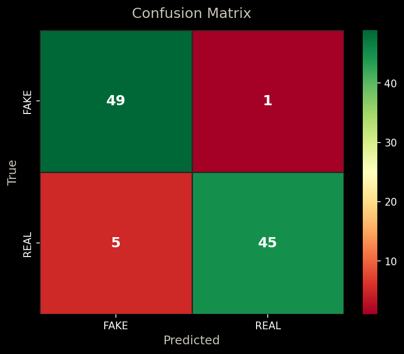
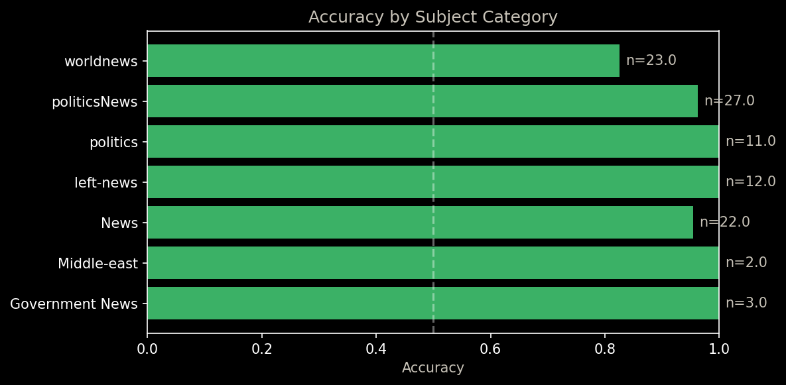

<p align="center"></p>

# Veritas Bureau — Multi-Agent Fake News Detection

A multi-agent LLM system that investigates a news article the way a newsroom would: it extracts the claims, checks them against live web search, scores bias and source credibility, and lets a Judge agent reach a `REAL` / `FAKE` verdict — with a Devil's Advocate agent that challenges low-confidence decisions. Every verdict comes with the evidence behind it, not just a label.

**Result:** 94% accuracy on a balanced, deduplicated sample of 100 articles from the ISOT Fake News dataset (49/50 fake and 45/50 real articles classified correctly).

`Python` · `LLM agents` · `Ollama / OpenAI` · `HuggingFace Transformers` · `Streamlit` · `DuckDuckGo search` · `pandas` · `scikit-learn`

## How it works

```
Article
  │
  ▼
Agent 1 — Claim Extractor
  │
  ▼
┌──────────────────────────────── parallel ─────────────────────────────┐
│ Agent 2 — Fact Checker (grounded in live DuckDuckGo search results)   │
│ Agent 3 — Bias Detector                                               │
│ Agent 5 — Source Credibility Analyzer                                 │
│ Tool    — BERT classifier (jy46604790/Fake-News-Bert-Detect)          │
└───────────────────────────────────┬───────────────────────────────────┘
                                    ▼
                           Agent 4 — Judge
                                    │  confidence < 0.90 ?
                                    ▼
                      Agent 6 — Devil's Advocate
                                    ▼
                              REAL / FAKE
```

- **Plain-Python orchestration** (no agent framework): each agent is a system prompt in `agents/prompts.py` plus a runner in `agents/runners.py`.
- **Parallel stage** via a thread pool (`pipeline/parallel.py`) to cut latency.
- **Robust JSON parsing** (`pipeline/json_parser.py`) so malformed LLM output doesn't break a batch run.
- **Swappable backend**: a local model through Ollama (default `qwen2.5:14b`) or the OpenAI API, set in `.env`.
- The Devil's Advocate stage was triggered on about half of the evaluated articles.

## Results

| | Predicted FAKE | Predicted REAL |
|---|---|---|
| **Actual FAKE** | 49 | 1 |
| **Actual REAL** | 5 | 45 |

<p>


</p>

More charts in [`results/`](results/) and an interactive [`results/dashboard.html`](results/dashboard.html). The full evaluation is in [`notebooks/notebook_2_evaluation.ipynb`](notebooks/notebook_2_evaluation.ipynb).

**Caveat:** the BERT tool was fine-tuned on the same ISOT dataset, so its share of the signal is probably flattered on this test set. The Judge treats it as a minor tiebreaker only.

## Run it

```bash
pip install -r requirements.txt
cp .env.example .env          # pick ollama or openai
ollama pull qwen2.5:14b       # if using the local backend

python test_pipeline.py       # quick smoke test
streamlit run app.py          # interactive UI
```

Batch evaluation:

```bash
# 1. Download the ISOT dataset (Fake.csv, True.csv) from Kaggle into data/
#    https://www.kaggle.com/datasets/clmentbisaillon/fake-and-real-news-dataset
python data/prepare_dataset.py
python batch_runner.py --input data/train.csv --output results/results.csv --sample 100 --workers 3
```

## Repository layout

```
agents/      prompts and runner functions for every agent
pipeline/    orchestration, parallel stage, web search, JSON parsing
app.py       Streamlit interface (single article + batch)
batch_runner.py  CLI batch processor with resume support
notebooks/   pipeline walkthrough and evaluation
results/     evaluation output and charts
docs/        technical documentation, design decisions, report and slides
```

## Context

Group project for the Master in Business Analytics & Data Science, IE University. See [`docs/TECHNICAL_DOCUMENTATION.md`](docs/TECHNICAL_DOCUMENTATION.md) for the full architecture and [`docs/DECISIONS.md`](docs/DECISIONS.md) for the design choices.
